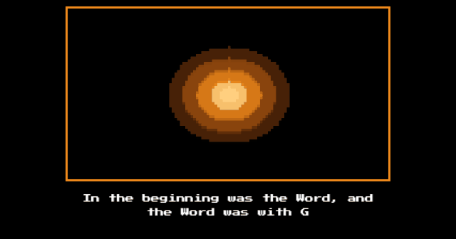
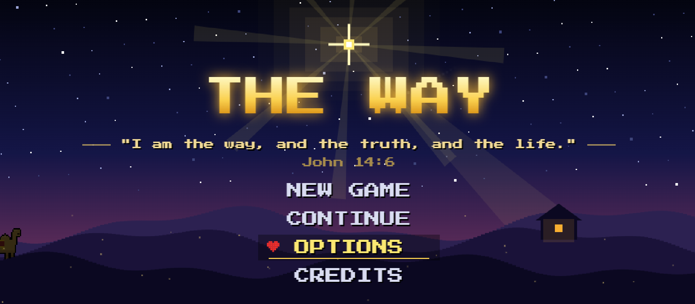
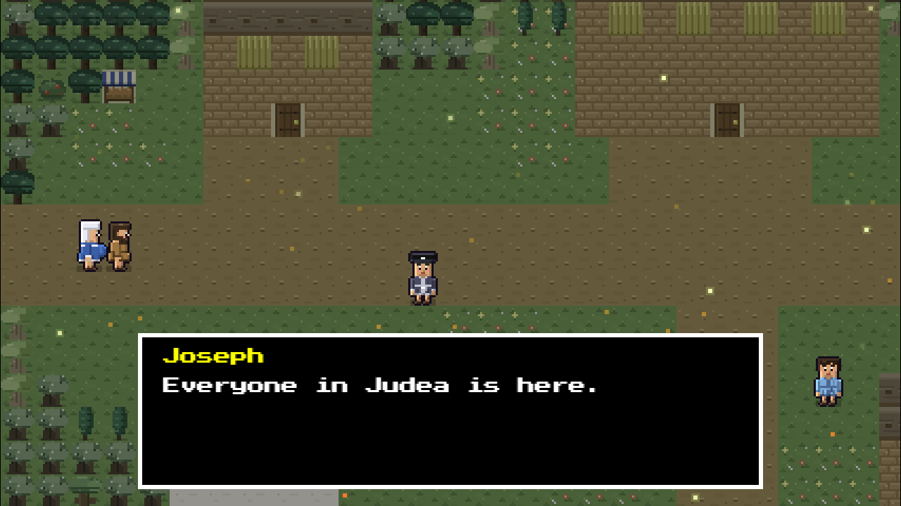
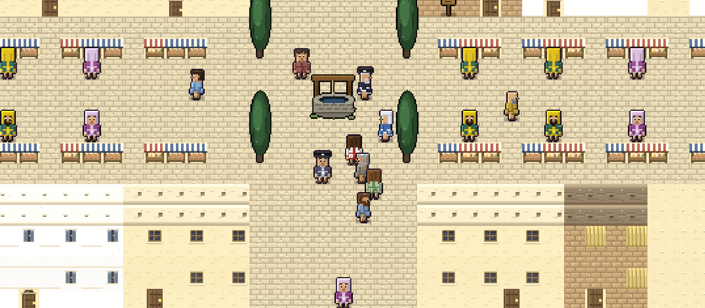
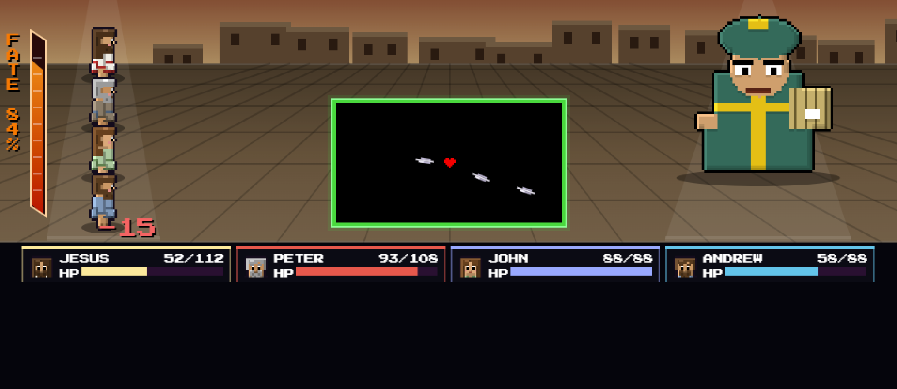

# The Way / La Voie

A 2D pixel-art RPG built from the four Gospels, compiled into a single story. Playable in **English and French**, on a computer or a phone.

Inspired by *Undertale* and *Deltarune*: every enemy can be spared, and every boss is a bullet-hell with its own mechanic.

Made by Christophe Maestro, 2026. A birthday gift for Guy la Guiche. Licence: GNU GPL v3.

## Screenshots





| Bethlehem (chapter 1) | Jerusalem (chapter 9) |
|---|---|
|  |  |



## Play

Open `index.html` in a recent browser (Chrome, Edge, Brave, Firefox, Safari). There is nothing to install and no server needed, and it works offline. It can also be hosted on any static web host.

### Controls

| Keyboard | Action |
|---|---|
| Arrow keys | Move, navigate menus |
| `Z`, `Enter`, `Space` | Confirm, talk |
| `X`, `Shift`, `Backspace` | Cancel; in a fight, move the heart slowly |
| `C`, `Esc` | Menu (items, party, stats, save, options) |
| `M` | Mute / unmute (remembered) |
| `Del` | On the save screen, erase a slot |

Letters are read by the printed character, so AZERTY keyboards work too.

**Phones and tablets:** an on-screen pad (bottom left) and `Z` / `X` / menu buttons (bottom right) appear automatically. Hold the pad and slide your thumb to change direction. Add `?touch=1` to the address to preview the controls on a computer.

### Saving

Three save slots. The game saves continuously while you walk, never during dialogue or a fight.

## The game

Twelve chapters. The main story takes about 2 hours, and the optional content (side areas, jars, lore NPCs, side scenes) can stretch it to 3 to 4 hours. Each chapter ends on a boss, and there is at most one mini-game per chapter.

| # | Chapter | Content |
|---|---|---|
| 1 | The Night of the Star | Joseph, Mary, Bethlehem, the Magi, Herod |
| 2 | The Voice in the Wilderness | John the Baptist, the baptism, the temptation |
| 3 | Fishers of Men | Cana, the great catch, the paralytic, the storm |
| 4 | Bread, Waves and Light | Legion, Jairus, the 5000, walking on water, the Transfiguration |
| 5 | Words on the Mountain | The Twelve, the Sermon on the Mount, Nain, the centurion |
| 6 | Stories by the Lake | The sower, the lost sheep, the Good Samaritan, the prodigal son |
| 7 | Living Water | The Samaritan woman, Nicodemus, Zacchaeus, the rich young man |
| 8 | Come Out! | Lazarus |
| 9 | Hosanna! | Palm Sunday, the Temple, the Last Supper |
| 10 | The Garden | Gethsemane, the arrest, Peter's denial |
| 11 | The Cross | Pilate, the Way of Sorrows, Golgotha, the tomb |
| 12 | The Third Day | The empty tomb, Emmaus, Thomas, breakfast by the lake, the Great Commission |

### Fights

- Every character has their own HP, level, colour and panel.
- Bullets hit one random party member at a time. Downed members are revived after the fight.
- **FATE** (the bar on the left) fills by grazing bullets and defending. Spend it on ACTs and on COMBOS between two characters (marked with a star).
- Every enemy can be spared with the right ACTs. The MERCY icon turns yellow when it is ready.

Maps are irregular, with in-between areas that have random encounters. You can walk back to earlier areas within a chapter.

## Options and debug

Options: language, sound, debug mode, replay the intro. Turning **debug mode** on adds:

- **Chapter select** (up/down = chapter, left/right = where to start inside it)
- **No fights**
- **Touch controls** on or off

These choices are remembered in the browser.

**Map viewer:** open `debug/maps.html` to browse every map chapter by chapter, drawn live by the game's own renderer at in-game resolution. Wheel = zoom, drag = pan, `[` `]` = previous / next map, optional grid and exit/trigger overlays. `?ch=6&map=boatshore` opens a map directly.

Useful addresses for testing:

| Address | Effect |
|---|---|
| `index.html?jump=ch5` | Start a chapter or area directly (ids are listed in chapter select) |
| `index.html?lang=fr` | Force French |
| `index.html?nointro=1` | Skip the opening |
| `index.html?touch=1` / `?touch=0` | Force the touch controls on / off |

## Music

One `.flac` file per situation, in `music/`:

| File | Plays during |
|---|---|
| `Map.flac` | Exploring roads, fields and other non-town maps |
| `Town.flac` | Exploring towns (Bethlehem, Nazareth, Capernaum, Nain, Jerusalem, the Temple, Jacob's Well, Jericho) |
| `Night.flac` | Title screen, intro, pause menu, night maps |
| `Holy.flac` | Sacred moments (Nativity, Baptism, Cana, Transfiguration, Last Supper, the ending) |
| `Desert.flac` | The wilderness and desert roads |
| `Dark.flac` | Grim places and scenes (Gethsemane, the Via Dolorosa, the tomb) |
| `Battle.flac` | Ordinary fights |
| `Boss.flac` | Boss fights |
| `Mini.flac` | Mini-games |

If a file is missing, the game falls back to a small built-in chiptune. The list of town maps is `Sound.TOWNS` in `js/core.js`.

## Project layout

```
index.html      page and script list
js/core.js      canvas, input, sound, translations, save data, scene stack
js/touch.js     on-screen touch controls
js/world.js     title, options, menus, map exploration
js/battle.js    fights (patterns*.js hold the bullet patterns)
js/minigames.js mini-games
js/ch1.js ... ch12.js   one file per chapter: maps, NPCs, scenes, bosses
js/equip.js, mapkit.js, kit.js, styles.js, sprites.js, cinema.js, main.js
fonts/          Press Start 2P (bundled, so the game works offline)
music/          the .flac tracks
```

## Credits

- Game: Christophe Maestro
- Music: Toby Fox
- Font: *Press Start 2P* by CodeMan38, SIL Open Font License 1.1
